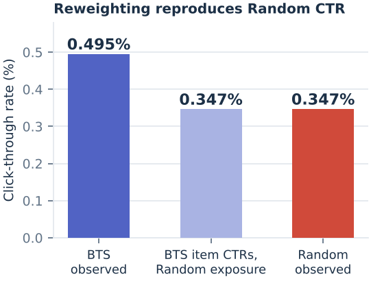
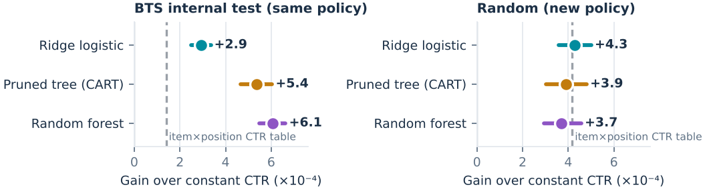
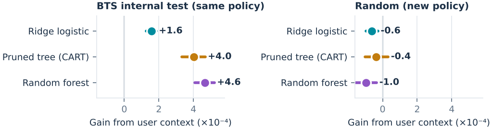
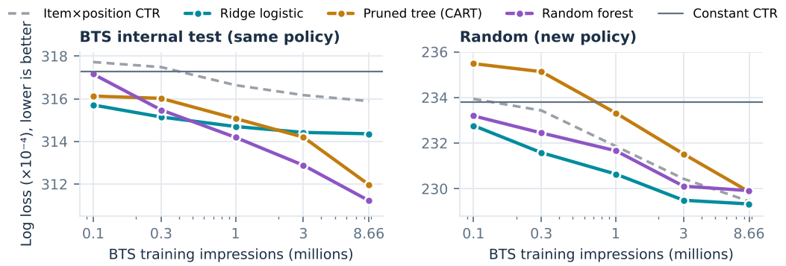

# The data remember the recommender

**Do click models survive a change of recommendation policy?** A study of cross-policy generalisation on 13.7 million marketplace impressions.

*Course project, Statistical and Machine Learning, WU Vienna (2026) · Dimitris Ntallas & Orest Mykhailiuk*

## Motivation: why marketplaces?

Marketplaces are one of the hardest settings for applied machine learning. A platform that matches two sides, such as buyers and sellers, patients and doctors, or clients and freelancers, decides through its ranking algorithm who gets seen by whom. That creates a feedback loop: the data the platform collects are shaped by the algorithm that collected them. Users can only click on what they were shown, so every log is a record of the old algorithm's choices as much as of user behaviour.

Improving the platform means changing that algorithm. The only clean way to know whether a new ranking really works is to run an online experiment (an A/B test), and for a start-up that is expensive:

- **Traffic is scarce.** Clicks are rare: in our data, about 1 in 200 impressions is clicked. At a click rate of about 0.4%, detecting a 5% relative change with standard power (80%, α = 5%) needs roughly **1.6 million impressions per variant**, which can take a young platform weeks or months.
- **Experiments carry risk.** A worse variant costs revenue and can damage the trust of both sides of the marketplace while the test runs.
- **Every test has a build cost.** Each variant has to be engineered, deployed and monitored.

So a start-up is tempted to do the cheap thing: train a model on the logs of its current algorithm and use it to design or judge the next one. **This project asks how far that shortcut can be trusted.** We can only answer it because a large platform has already paid for the experiment: the Open Bandit Dataset logs the same shop, in the same week, under two different recommendation policies, with traffic split at random.

### What this means for a start-up

- **Keep a small randomised slice of traffic.** It is cheap insurance: it gives an honest test set for whatever policy comes next. In our data, the model that looked best on the old logs lost to the simplest one under the new policy.
- **Prefer simple, transferable signals until contextual gains are validated.** Item-level effects carried over to the new policy; gains from user features did not.
- **More data from the old algorithm is not a substitute for data from the new one.** It improved every model, but it did not preserve the flexible models' advantage.
- **Audit your categorical data across sources.** One relabelled user segment created a large artificial effect in our first pass.

---

## Research question

When a platform switches to a different recommendation policy, does a click model trained on the old policy's logs remain accurate?

We use the [Open Bandit Dataset](https://github.com/st-tech/zr-obp) from ZOZOTOWN, Japan's largest fashion e-commerce platform. It comes from an A/B test in which every impression was randomly served by one of two policies in the same week:

- **BTS** (Bernoulli Thompson Sampling), an adaptive policy that shows more of what earned clicks before (12.36m impressions)
- **Random**, which shows the 80 items uniformly (1.37m impressions)

We train only on BTS and treat Random as "the future after the switch".

📄 **[Slides (PDF)](presentation/presentation.pdf)** · 📊 [Results](results/) · 💾 [Data](data/)

## Key findings

**1. The overall click rate drops (0.495% → 0.347%), mostly because of what gets shown.** BTS concentrates 59% of impressions on its 10 favourite items. If we keep each item's BTS click rate but show items the way Random does, we get 0.347%, exactly Random's rate.

<p align="center"></p>

**2. Flexible models win on BTS, but not after the switch.** All three models beat a constant click-rate baseline on both logs. On BTS the random forest gains twice as much as ridge regression. On Random the ranking is no longer confirmed, and a simple item × position click-rate table does as well as any model.

<p align="center"></p>

**3. The extra signal came from user features, and it did not carry over.** Adding the four user features is what gives the trees most of their BTS advantage. On Random, the same features make every model slightly worse.

<p align="center"></p>

**4. More old-policy data improves every model, but the gaps close after the switch.** We retrained every model on 0.1m to 8.66m impressions, re-tuning at each size. On BTS the trees keep pulling away from ridge. On Random all models end up within 0.6 × 10⁻⁴ log loss of each other.

<p align="center"></p>

| Gain over constant CTR (log loss × 10⁻⁴, 95% CI) | BTS test | Random |
|---|---|---|
| Ridge logistic | +2.9 [2.5, 3.4] | +4.3 [3.6, 5.0] |
| Pruned tree (CART) | +5.4 [4.7, 6.0] | +3.9 [3.0, 4.8] |
| Random forest (final model) | +6.1 [5.5, 6.6] | +3.7 [2.9, 4.6] |
| **Gain from adding user features** | | |
| Ridge / CART / forest | +1.6 / +4.0 / +4.6 | −0.6 / −0.4 / −1.0 |

Intervals come from a paired bootstrap over calendar-minute blocks within each day (1,000 draws). Full tables are in [`results/`](results/) and the backup slides.

### A data-quality finding

Each of the four anonymised user features has exactly **one** code in Random that never appears in BTS. All four always occur together, on 35.4% of Random rows. BTS has the mirror image: a profile never seen in Random, on 35.3% of its rows. Because assignment was random, these are most likely the same user segment hashed differently in the two files. This is an inference, since the codes are undocumented.

With a standard "unseen → UNKNOWN" encoding, the UNKNOWN coefficient is never trained. In our first pass, this exaggerated the apparent cross-policy penalty of user features about 49-fold. The main analysis maps the two profiles onto each other, using feature codes only and never Random's clicks. Every result is also checked on matched-code rows only, which need no mapping.

---

## Methods

| | Ridge logistic regression | Classification tree (CART) | Random forest |
|---|---|---|---|
| Model | additive log-odds, L2 penalty | Gini splits, cost-complexity pruning | 300 bootstrapped trees, random feature subsets |
| Tuned | C ∈ 10⁻³ … 10³ | pruning level × min leaf × leaf smoothing | features per split × min leaf (21 configs) |

- **Task:** predict P(click | item, position, user profile), with 6 categorical predictors and about 1 click per 200 impressions.
- **Variable selection:** every method is fitted with item + position, and with the four user features added.
- **Split:** BTS split 70/15/15 into train, validation and test by calendar-minute blocks within each day. All tuning uses BTS validation log loss. Random is never used for fitting or tuning.
- **Metric:** log loss (a proper scoring rule), with AUC and calibration as checks.
- **Exact fitting at full scale:** every impression is one of about 61k (item, position, profile) patterns. Models are fitted on pattern counts, with clicks and non-clicks as weights. This gives the same likelihood, Gini splits and pruning path as the 8.66m raw rows. The forest bootstrap uses Poisson(1) weights.
- **Excluded features:** logged propensities and user-item affinity scores, because they are produced by the logging policy itself.

---

## Repository structure

```
├── presentation/      Final slides (PDF) and Beamer source; numbers.tex and tab_*.tex are generated
├── analysis/          Corrected analysis pipeline (tuning, evaluation, bootstrap, figures)
├── results/           All result tables: metrics, bootstrap intervals, tuning grids, learning curves
├── src/marketplace_ml Data preparation: raw ZIP → compact arrays and the frozen minute-block split
├── tests/             Unit tests for the data-preparation code
├── data/processed/    The dataset in compressed form (≈30 MB) + checksums; see data/README.md
└── docs/img/          Figures used in this README
```

## Reproducing the results

The processed dataset ships with the repository, so no download is needed.

```bash
pip install -r requirements.txt
PYTHONPATH=src python -m unittest discover -s tests

# 1. Unpack the data and rebuild the frozen minute-block split (checked against SHA256 checksums)
python analysis/unpack_data.py

# 2. Analysis (about an hour on a laptop; most of it is forest tuning and the learning curves)
python analysis/eda.py
python analysis/run_all.py                    # tune all models on BTS validation, evaluate, bootstrap
python analysis/forest_ext.py && python analysis/forest_ext2.py   # extended forest grid
python analysis/evaluate_final.py 0.1 3e-6    # refit the selected forest with 300 trees
python analysis/final_model.py                # calibration, importance, extra contrasts
python analysis/curve.py                      # learning curves, re-tuned at every size
python analysis/naive_encoding_refit.py       # first-pass encoding diagnosis

# 3. Figures, numbers and slides
for f in fig_eda fig_results fig_curve fig_tuning make_numbers; do python analysis/$f.py; done
cd presentation && pdflatex main.tex && pdflatex main.tex
```

Every number on the slides is generated from `results/` by `analysis/make_numbers.py`; none is typed by hand.

To start from the original raw CSV files instead, download the full dataset (see [`data/README.md`](data/README.md)) and run `marketplace_ml.pilot` followed by `marketplace_ml.prepare_full` (seed 20261114). This produces the same arrays.

## Limitations

- One shop, one week, one A/B test: the results describe this policy shift, not every policy change.
- The profile mapping is an inference; the matched-code results do not depend on it.
- Predicting clicks is not the same as valuing a policy. That would need off-policy evaluation, which is what the dataset was built for.
- Our first-pass analysis did look at Random results; that is how the encoding issue was found. The corrected pipeline makes every fitting and tuning choice on BTS, but Random is not a pre-registered holdout.
- Minute-block splitting limits, but cannot fully rule out, the same user appearing in train and test (there are no user IDs).
- A natural next step we did not try: reweighting BTS training rows by inverse propensity to mimic uniform exposure.

## References

- Saito, Aihara, Matsutani, Narita (2021). *Open Bandit Dataset and Pipeline: Towards Realistic and Reproducible Off-Policy Evaluation.* NeurIPS Datasets and Benchmarks. [arXiv:2008.07146](https://arxiv.org/abs/2008.07146)
- James, Witten, Hastie, Tibshirani. *An Introduction to Statistical Learning.*
- Breiman, Friedman, Olshen, Stone (1984). *Classification and Regression Trees.*

## Authors

Dimitris Ntallas and Orest Mykhailiuk, Statistical and Machine Learning, WU Vienna (2026).

## License

- **Code:** MIT (see [`LICENSE`](LICENSE)).
- **Data:** the Open Bandit Dataset is provided by ZOZO, Inc. under [CC BY 4.0](https://creativecommons.org/licenses/by/4.0/). The files in `data/processed/` are a compressed re-encoding of its "All" campaign. If you use them, please cite Saito et al. (2021) above.
